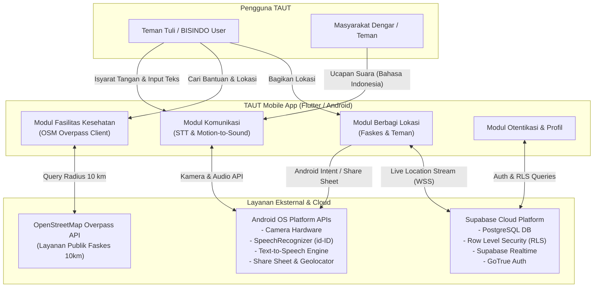
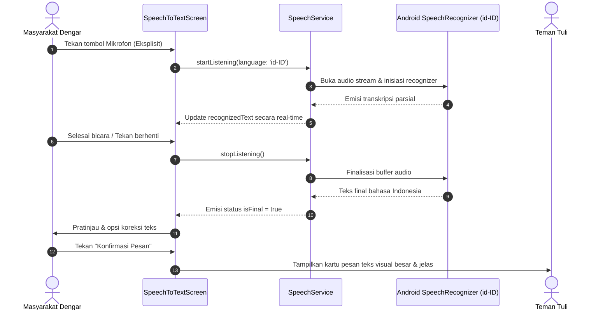
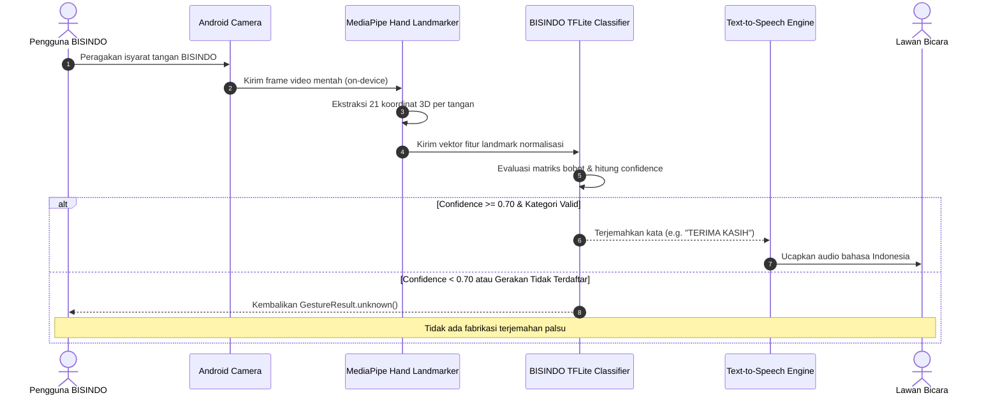
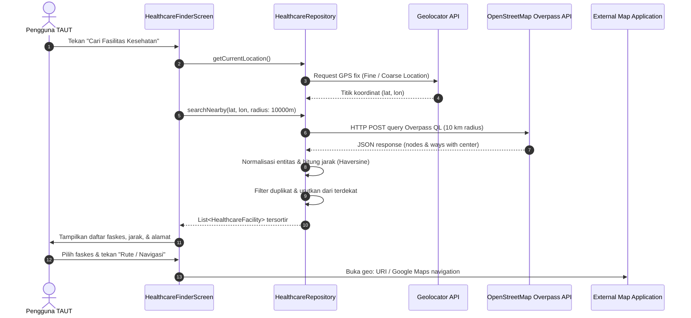
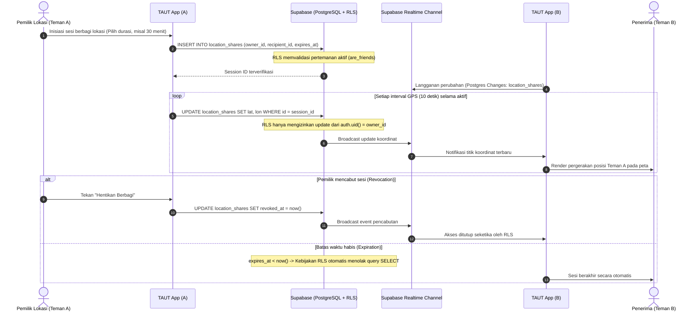

# ARCHITECTURE.md — TAUT System Architecture & Technical Specifications

> **Project**: TAUT (Aksesibilitas & Komunikasi Inklusif)  
> **Competition**: INCEPTION 2026 Hackathon  
> **Team**: Mardua Holong (Universitas Brawijaya)  
> **Stage**: 01 — Project Foundation & Architecture

---

## 1. System Overview & Context

TAUT is an Android accessibility application designed to bridge communication barriers for Deaf and Hard-of-Hearing individuals (specifically Indonesian Sign Language / BISINDO users) when interacting with hearing peers and accessing nearby emergency healthcare services.

### Core Capabilities
1. **Two-Way Communication**:
   - **Speech-to-Text**: Captures spoken Indonesian (`id-ID`) via native Android speech recognition and presents confirmed, high-contrast text to Deaf users.
   - **Motion-to-Sound**: Captures hand gestures via Android camera, extracts landmark coordinates, classifies gestures using a BISINDO word-level model, and speaks aloud using Text-to-Speech (TTS).
2. **Healthcare Finder**:
   - Locates nearby healthcare facilities (hospitals, clinics, doctors, pharmacies) within a 10 km radius using OpenStreetMap Overpass API and provides external navigation links.
3. **Location Sharing to Healthcare Recipients**:
   - Allows users to share their current location coordinates and Google Maps link via Android Share Sheet (`share_plus`) directly to external channels without requiring database overhead.
4. **Friend-to-Friend Live Location Sharing**:
   - Facilitates real-time, authorized foreground location streaming between verified friends using Supabase PostgreSQL with Row Level Security (RLS) and Supabase Realtime.

---

## 2. System Context Diagram (Mermaid)



---

## 3. Component Architecture Diagram (Mermaid)

```mermaid
flowchart TD
    subgraph PresentationLayer["Presentation Layer (Flutter UI / Material 3)"]
        HomeShell["HomeShellScreen (4 Bottom Tabs)"]
        CommHub["CommunicationHubScreen"]
        STTView["SpeechToTextScreen"]
        MTSView["MotionToSoundScreen"]
        HealthView["HealthcareFinderScreen"]
        ShareView["LocationSharingScreen"]
        FriendView["FriendsPlaceholderScreen"]
        ProfileView["ProfileScreen & PrivacyPolicyScreen"]
    end

    subgraph CoreFoundation["Core & Shared Foundation"]
        Theme["AppTheme (M3)"]
        Router["AppRouter"]
        DistCalc["DistanceCalculator (Haversine stdlib)"]
        PermService["PermissionService"]
        Config["AppConfig & Env"]
    end

    subgraph DomainLayer["Domain Layer (Contracts & Entities)"]
        AuthRepo["AuthRepository Contract"]
        FriendRepo["FriendsRepository Contract"]
        LocRepo["LocationSharingRepository Contract"]
        HealthRepo["HealthcareRepository Contract"]
        HealthShare["HealthcareShareService Contract"]
        SpeechSvc["SpeechService Contract"]
        BisindoSvc["BisindoRecognitionService Contract"]
        TtsSvc["TtsService Contract"]
    end

    subgraph DataLayer["Data Layer (Repositories & API Sources)"]
        AuthImpl["AuthRepositoryImpl (Supabase GoTrue)"]
        FriendImpl["FriendsRepositoryImpl (Postgres RLS)"]
        LocImpl["LocationSharingRepositoryImpl (Supabase Realtime)"]
        HealthImpl["HealthcareRepositoryImpl (HTTP Client)"]
        OSMService["OsmOverpassService (QL Builder)"]
        HealthShareImpl["HealthcareShareServiceImpl (share_plus)"]
        SpeechImpl["SpeechServiceImpl (Android SpeechRecognizer)"]
        BisindoImpl["BisindoRecognitionServiceImpl (TFLite)"]
        TtsImpl["TtsServiceImpl (flutter_tts)"]
    end

    HomeShell --> CommHub & HealthView & ShareView & ProfileView
    CommHub --> STTView & MTSView
    ShareView --> FriendView

    STTView -.-> SpeechSvc
    MTSView -.-> BisindoSvc & TtsSvc
    HealthView -.-> HealthRepo
    ShareView -.-> HealthShare & LocRepo
    FriendView -.-> FriendRepo

    SpeechSvc <|-- SpeechImpl
    BisindoSvc <|-- BisindoImpl
    TtsSvc <|-- TtsImpl
    HealthRepo <|-- HealthImpl
    HealthImpl --> OSMService & DistCalc
    HealthShare <|-- HealthShareImpl
    LocRepo <|-- LocImpl
    FriendRepo <|-- FriendImpl
    AuthRepo <|-- AuthImpl
```

---

## 4. Feature Flow Architectures

### 4.1. Speech-to-Text Flow (Indonesian Speech Recognition)



### 4.2. Motion-to-Sound Flow (BISINDO to TTS)



### 4.3. Healthcare Finder Flow (OSM Overpass 10 km Radius)



### 4.4. Friend-to-Friend Location Sharing Sequence (Supabase Realtime)



---

## 5. Technology Decisions & Rationale

| Layer | Chosen Technology | Justification / Trade-off |
| :--- | :--- | :--- |
| **Mobile Framework** | Flutter 3.47.7 (Dart 3.13.5) | Cross-platform Material 3 accessibility widgets, native Android channel performance, zero build-generator drag. |
| **State Management** | Native `ChangeNotifier` / `ValueNotifier` + `ListenableBuilder` | Zero external dependency weight, no code generators (`freezed`/`build_runner`), eliminating cross-developer merge conflicts. |
| **Backend & Auth** | Supabase Cloud (PostgreSQL + RLS) | Built-in authentication, instant WebSocket Realtime sync, row-level declarative security, eliminate redundant custom Node.js servers. |
| **Geospatial Distance** | Native Dart Haversine formula (`DistanceCalculator`) | Standard library `dart:math`, eliminates unneeded external mapping plugins for raw distance calculation. |
| **Healthcare Source** | OpenStreetMap Overpass API | Open, free, globally accessible, no proprietary billing or vendor lock-in for hackathon demonstration. |
| **Speech Pipeline** | Android native SpeechRecognizer (`id-ID`) | Low latency, native Indonesian language acoustic models pre-installed on Android devices. |
| **Vision Inference** | MediaPipe Landmarker + TFLite | Isolates computer vision extraction from classification logic; allows word-level BISINDO model swapping without touching the UI. |

---

## 6. Architecture Limitations & Operational Boundaries

1. **Healthcare Accessibility Metadata**:
   OpenStreetMap tags rarely document wheelchair ramps, sign language interpreters, or physical disability access. TAUT strictly marks accessibility as unverified unless `wheelchair=yes` is explicitly tagged.
2. **BISINDO Vocabulary Scope**:
   TAUT Stage 01/02 targets an isolated word-level vocabulary (8–20 emergency and daily communication words). It is **not** an open-ended sentence translator.
3. **Location Tracking Mode**:
   Only **foreground** location updates are supported in the MVP. Stealth or background geofencing is deliberately omitted for battery efficiency, privacy protection, and hackathon scope containment.
