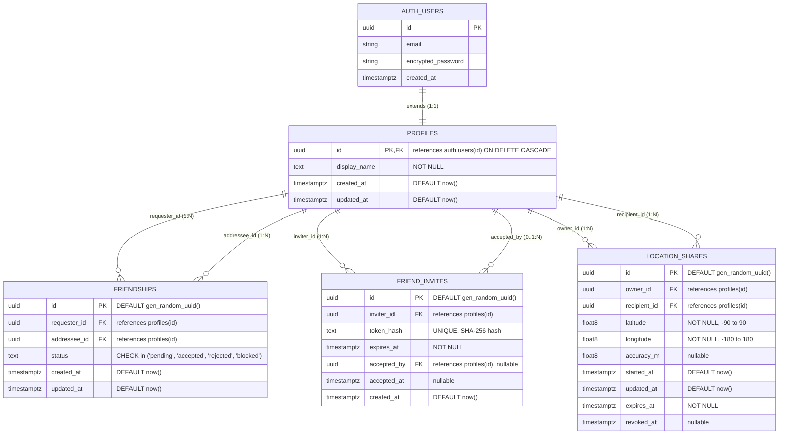

# DATABASE_DESIGN.md — PostgreSQL Database Schema & Security Architecture

> **Project**: TAUT  
> **Author**: Alfredo Jonathan Purba (Team Lead & Database Architect)  
> **Migration Draft**: `supabase/migrations/20261031000001_initial_schema.sql`

---

## 1. Entity-Relationship Diagram (ERD)



---

## 2. Table Specifications & Constraints

### 2.1. `public.profiles`
Extends Supabase `auth.users` with accessible public metadata.
- `id`: `UUID PRIMARY KEY REFERENCES auth.users(id) ON DELETE CASCADE`
- `display_name`: `TEXT NOT NULL`
- `created_at`: `TIMESTAMPTZ NOT NULL DEFAULT timezone('utc'::text, now())`
- `updated_at`: `TIMESTAMPTZ NOT NULL DEFAULT timezone('utc'::text, now())`

### 2.2. `public.friendships`
Manages bilateral connections between users.
- `id`: `UUID PRIMARY KEY DEFAULT gen_random_uuid()`
- `requester_id`: `UUID NOT NULL REFERENCES public.profiles(id) ON DELETE CASCADE`
- `addressee_id`: `UUID NOT NULL REFERENCES public.profiles(id) ON DELETE CASCADE`
- `status`: `TEXT NOT NULL CHECK (status IN ('pending', 'accepted', 'rejected', 'blocked'))`
- `created_at`: `TIMESTAMPTZ NOT NULL DEFAULT timezone('utc'::text, now())`
- `updated_at`: `TIMESTAMPTZ NOT NULL DEFAULT timezone('utc'::text, now())`
- **Constraints**:
  - `check_no_self_friendship`: `CHECK (requester_id <> addressee_id)`
  - Symmetrical uniqueness index:
    `CREATE UNIQUE INDEX idx_friendships_unique_pair ON public.friendships (LEAST(requester_id, addressee_id), GREATEST(requester_id, addressee_id));`
    *Prevents User A from inviting User B while User B also has an invite to User A.*

### 2.3. `public.friend_invites`
Cryptographic invite tokens for QR codes and deep links.
- `id`: `UUID PRIMARY KEY DEFAULT gen_random_uuid()`
- `inviter_id`: `UUID NOT NULL REFERENCES public.profiles(id) ON DELETE CASCADE`
- `token_hash`: `TEXT NOT NULL UNIQUE` (Stores SHA-256 hash of the token string; plain secret is never saved in the database)
- `expires_at`: `TIMESTAMPTZ NOT NULL`
- `accepted_by`: `UUID REFERENCES public.profiles(id) ON DELETE SET NULL`
- `accepted_at`: `TIMESTAMPTZ`
- `created_at`: `TIMESTAMPTZ NOT NULL DEFAULT timezone('utc'::text, now())`

### 2.4. `public.location_shares`
Live foreground location streaming records.
- `id`: `UUID PRIMARY KEY DEFAULT gen_random_uuid()`
- `owner_id`: `UUID NOT NULL REFERENCES public.profiles(id) ON DELETE CASCADE`
- `recipient_id`: `UUID NOT NULL REFERENCES public.profiles(id) ON DELETE CASCADE`
- `latitude`: `DOUBLE PRECISION NOT NULL CHECK (latitude >= -90.0 AND latitude <= 90.0)`
- `longitude`: `DOUBLE PRECISION NOT NULL CHECK (longitude >= -180.0 AND longitude <= 180.0)`
- `accuracy_m`: `DOUBLE PRECISION`
- `started_at`: `TIMESTAMPTZ NOT NULL DEFAULT timezone('utc'::text, now())`
- `updated_at`: `TIMESTAMPTZ NOT NULL DEFAULT timezone('utc'::text, now())`
- `expires_at`: `TIMESTAMPTZ NOT NULL`
- `revoked_at`: `TIMESTAMPTZ`
- **Constraint**: `CHECK (owner_id <> recipient_id)`

---

## 3. Row Level Security (RLS) Access Matrix

All 4 tables have `ROW LEVEL SECURITY` enabled. Anonymous / unauthenticated access is strictly forbidden (`TO authenticated`).

| Table | Operation | Allowed Roles / Identities | Mandatory Security Condition |
| :--- | :--- | :--- | :--- |
| `profiles` | `SELECT` | `authenticated` | `true` (Public user directory for search/friends) |
| `profiles` | `INSERT` | Owner only | `auth.uid() = id` |
| `profiles` | `UPDATE` | Owner only | `auth.uid() = id` |
| `friendships` | `SELECT` | Involved users | `auth.uid() = requester_id OR auth.uid() = addressee_id` |
| `friendships` | `INSERT` | Requester | `auth.uid() = requester_id` |
| `friendships` | `UPDATE` | Involved users | `auth.uid() = requester_id OR auth.uid() = addressee_id` |
| `friend_invites` | `SELECT` | Inviter or valid token | `inviter_id = auth.uid() OR (accepted_at IS NULL AND expires_at > now())` |
| `friend_invites` | `INSERT` | Inviter | `inviter_id = auth.uid()` |
| `friend_invites` | `UPDATE` | Acceptor / Inviter | `accepted_by = auth.uid() OR inviter_id = auth.uid()` |
| `location_shares`| `SELECT` | Owner & Designated Recipient | `(owner_id = auth.uid() OR recipient_id = auth.uid()) AND revoked_at IS NULL AND expires_at > now() AND are_friends(owner_id, recipient_id)` |
| `location_shares`| `INSERT` | Owner only | `owner_id = auth.uid() AND are_friends(owner_id, recipient_id)` |
| `location_shares`| `UPDATE` | **Owner only** | `auth.uid() = owner_id` (*Recipient CANNOT alter location!*) |
| `location_shares`| `DELETE` | Owner only | `auth.uid() = owner_id` |

---

## 4. Friendship Verification Function
Database-level function preventing unauthorized location visibility:

```sql
CREATE OR REPLACE FUNCTION public.are_friends(user_a UUID, user_b UUID)
RETURNS BOOLEAN AS $$
BEGIN
  RETURN EXISTS (
    SELECT 1 FROM public.friendships
    WHERE status = 'accepted'
      AND (
        (requester_id = user_a AND addressee_id = user_b) OR
        (requester_id = user_b AND addressee_id = user_a)
      )
  );
END;
$$ LANGUAGE plpgsql SECURITY DEFINER;
```

---

## 5. Performance Indexes & Realtime Setup

```sql
-- Indexes for low-latency Realtime queries
CREATE INDEX idx_friendships_requester ON public.friendships(requester_id);
CREATE INDEX idx_friendships_addressee ON public.friendships(addressee_id);
CREATE INDEX idx_location_shares_active ON public.location_shares(owner_id, recipient_id, expires_at) WHERE revoked_at IS NULL;
CREATE INDEX idx_friend_invites_token_hash ON public.friend_invites(token_hash);

-- Realtime publication
ALTER PUBLICATION supabase_realtime ADD TABLE public.location_shares;
```

---

## 6. Retention and Cleanup Policy
1. Expired sessions (`expires_at < now()`) become instantly invisible to recipients due to the RLS filter.
2. Sessi records with `revoked_at IS NOT NULL` remain visible only to the owner for audit history and can be purged via a scheduled PostgreSQL cron job (`pg_cron`) after 7 days:
   ```sql
   DELETE FROM public.location_shares WHERE (revoked_at IS NOT NULL OR expires_at < now() - INTERVAL '7 days');
   ```
