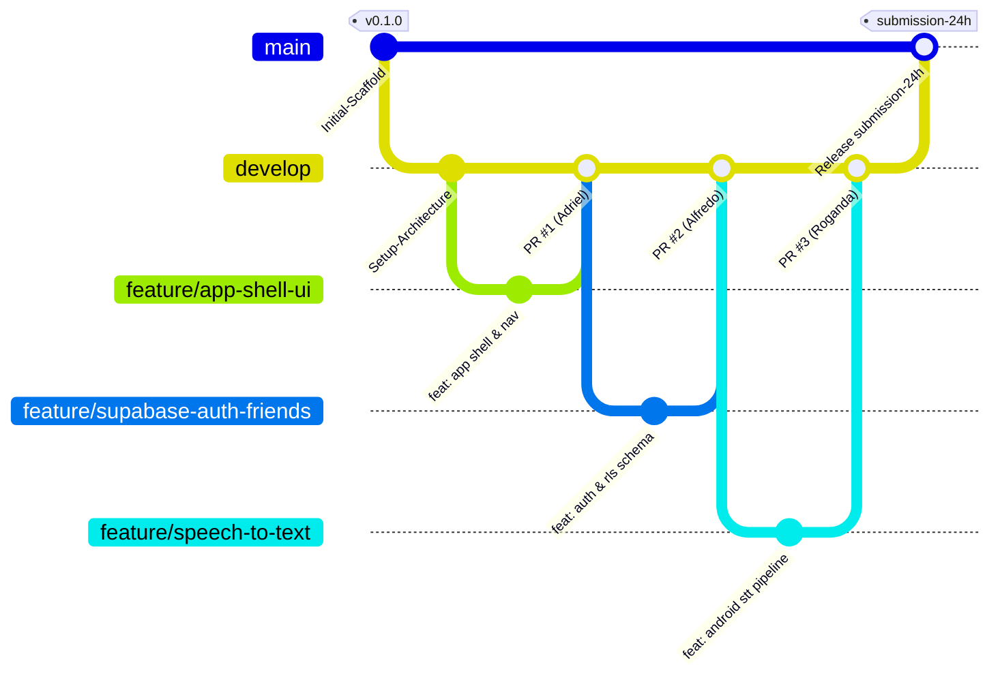

# DEVELOPMENT_WORKFLOW.md — Git Branching, Collaboration & Release Strategy

> **Project**: TAUT  
> **Team**: Mardua Holong (INCEPTION 2026 Hackathon)

---

## 1. Git Branching Model & Architecture



---

## 2. Branch Hierarchy & Ownership

| Branch | Base | Target | Owner | Description |
| :--- | :--- | :--- | :--- | :--- |
| `main` | - | - | All (Lead approval) | Stable production branch. Only tested, working code merges here. |
| `develop` | `main` | `main` | All | Primary integration branch for sprint features. |
| `feature/app-shell-ui` | `develop` | `develop` | Adriel | Material 3 navigation bar, accessible UI widgets, themes. |
| `feature/healthcare-finder` | `develop` | `develop` | Adriel | Geolocator, OpenStreetMap Overpass client, 10 km filtering. |
| `feature/share-location-faskes`| `develop` | `develop` | Adriel | Android Share Sheet (`share_plus`) emergency location intent. |
| `feature/supabase-auth-friends`| `develop` | `develop` | Alfredo | Supabase GoTrue Auth, profile management, friend invites. |
| `feature/friend-location-sharing`| `develop` | `develop`| Alfredo | Supabase Realtime live location updates & RLS policies. |
| `feature/speech-to-text` | `develop` | `develop` | Roganda | Android SpeechRecognizer, microphone permissions, id-ID model. |
| `feature/motion-to-sound` | `develop` | `develop` | Roganda | Camera input, MediaPipe landmarks, TFLite BISINDO, TTS audio. |

---

## 3. Commit Convention (Conventional Commits)

All commits must follow the conventional commit format:
```text
<type>(<scope>): <short description in present tense>
```

### Supported Types:
- `feat`: New feature or user-facing capability.
- `fix`: Bug fix in logic or UI.
- `docs`: Documentation updates or additions.
- `style`: Formatting, whitespace changes (`dart format`).
- `refactor`: Code change that neither fixes a bug nor adds a feature.
- `test`: Adding or correcting tests.
- `chore`: Dependency updates, build configurations.

### Examples:
- `feat(healthcare): implement overpass api 10km radius query`
- `fix(location): enforce owner-only rls policy on location update`
- `docs(agents): update integration contract for speech service`

---

## 4. Pull Request & Code Review Protocol

1. **Self-Verification Before PR**:
   Before opening a Pull Request into `develop`, the author must run locally:
   ```bash
   dart format .
   flutter analyze
   flutter test
   ```
2. **Pull Request Guidelines**:
   - Title must clearly reference the feature (e.g., `feat(auth): integrate Supabase GoTrue client`).
   - Description must link to the contract and list tested scenarios.
   - At least **one review approval** from a teammate is required before merging.
3. **Never Force-Push**:
   - `git push --force` to `main` or `develop` is strictly forbidden.
4. **Final Hackathon Submission**:
   - When all features on `develop` are verified end-to-end, `develop` is merged into `main`.
   - The release is tagged:
     ```bash
     git tag submission-24h
     git push origin submission-24h
     ```
