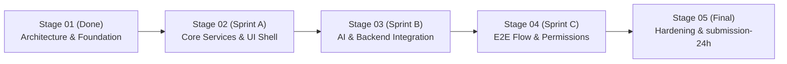
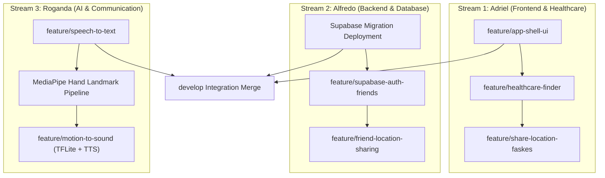

# IMPLEMENTATION_PLAN.md — Stage Milestones, Task Breakdown & Risk Matrix

> **Project**: TAUT  
> **Competition**: INCEPTION 2026 Hackathon  
> **Team**: Mardua Holong (Universitas Brawijaya)

---

## 1. Development Milestones & Roadmap

### Milestone Breakdown:
- **Milestone 1 (Stage 01 - CURRENT)**:
  - Repository audit, architecture blueprint, database design, RLS migration draft, integration contracts, navigable application skeleton, quality checks.
- **Milestone 2 (Stage 02 - Sprint A)**:
  - Adriel: App shell UI polish, OpenStreetMap Overpass client with 10 km filtering.
  - Alfredo: Supabase Auth integration, profile sync, friend invite creation/acceptance.
  - Roganda: Android SpeechRecognizer pipeline (`speech_to_text`), Indonesian language audio testing.
- **Milestone 3 (Stage 03 - Sprint B)**:
  - Adriel: Healthcare location sharing via Android Share Sheet (`share_plus`).
  - Alfredo: Friend live location streaming via Supabase Realtime & RLS policies.
  - Roganda: Camera integration, MediaPipe Hand Landmarker, TFLite word-level BISINDO inference, TTS audio.
- **Milestone 4 (Stage 04 - Sprint C)**:
  - Cross-module integration, real Android device testing, permission handling, offline graceful degradation.
- **Milestone 5 (Stage 05 - Release)**:
  - Release APK build, manual QA smoke test, final tag `submission-24h`.

---

## 2. Dependency Order

---

## 3. Detailed Work Breakdown by Member

### 3.1. Alfredo Jonathan Purba (Team Lead & Backend)
1. **Task B1**: Deploy SQL migration `supabase/migrations/20261031000001_initial_schema.sql` to team Supabase instance.
2. **Task B2**: Implement `AuthRepositoryImpl` with `supabase_flutter` (sign up, sign in, session persistence).
3. **Task B3**: Implement `FriendsRepositoryImpl` (generate invite tokens, redeem tokens, list friends).
4. **Task B4**: Implement `LocationSharingRepositoryImpl` (write GPS updates, Supabase Realtime channel subscription).

### 3.2. Adriel Christo Lumbantoruan (Frontend & Healthcare)
1. **Task A1**: Implement `HealthcareRepositoryImpl` with `http` client querying Overpass API.
2. **Task A2**: Parse and normalize OSM nodes and ways into `HealthcareFacility` models.
3. **Task A3**: Render sorted healthcare cards with distance badges and map navigation links via `url_launcher`.
4. **Task A4**: Implement `HealthcareShareServiceImpl` with `share_plus` Android Share Sheet intent and user confirmation dialog.

### 3.3. Roganda Tua Tampubolon (Communication AI & Vision)
1. **Task C1**: Implement `SpeechServiceImpl` with `speech_to_text` (microphone permission, `id-ID` locale, partial/final events).
2. **Task C2**: Build high-contrast conversation display for deaf users with confirmation and edit actions.
3. **Task C3**: Integrate camera frame listener with MediaPipe Hand Landmarker to extract 21 3D landmarks.
4. **Task C4**: Integrate TFLite isolated word classifier for BISINDO vocabulary and wire output to `flutter_tts`.

---

## 4. Risk Analysis & Mitigation Matrix

| Risk ID | Identified Risk | Severity | Mitigation Strategy |
| :--- | :--- | :--- | :--- |
| **R1** | Overpass API rate limits or slow response during live demo | High | Cache query results locally in memory for 5 minutes; handle HTTP timeouts gracefully with retry button. |
| **R2** | BISINDO model overfitting or poor generalization under low light | High | Restrict initial model to 8–10 distinct word-level gestures; return `GestureResult.unknown()` instead of guessing. |
| **R3** | Android SpeechRecognizer unavailable offline on certain ROMs | Medium | Display clear error message indicating network requirement; offer text-typing fallback. |
| **R4** | GPS drift or permission denial by user | Medium | Check permission status explicitly with `PermissionCard`; fallback to coarse location if fine GPS is denied. |
| **R5** | Merge conflicts across feature branches | Medium | Strict modular boundary isolation: Alfredo in `features/auth` & `friends`, Adriel in `healthcare`, Roganda in `communication`. |

---

## 5. Definition of Done (DoD) for Future Sprints

A feature branch may only be merged into `develop` when:
1. All methods defined in `INTEGRATION_CONTRACTS.md` for that module are fully implemented.
2. `dart format .` produces 0 formatting discrepancies.
3. `flutter analyze` passes with 0 errors and 0 warnings.
4. Relevant unit/widget tests are created and pass via `flutter test`.
5. Code does not leak secrets, `.env`, or sensitive credentials into Git.
6. The feature has been tested on an Android emulator or physical device.
7. PR is reviewed and approved by at least one teammate.
